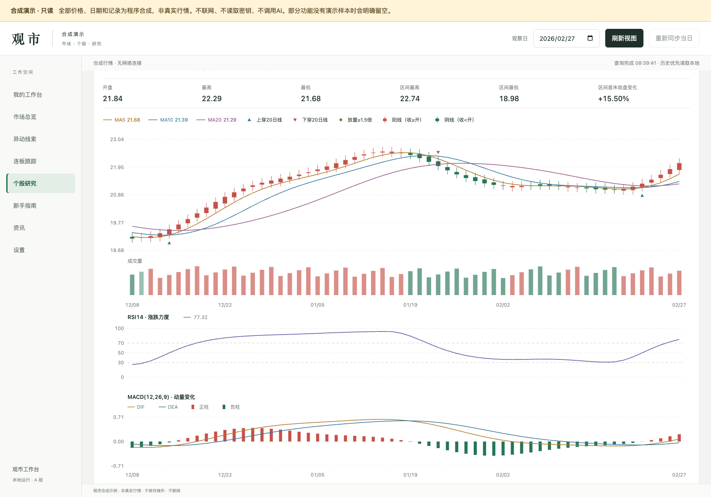
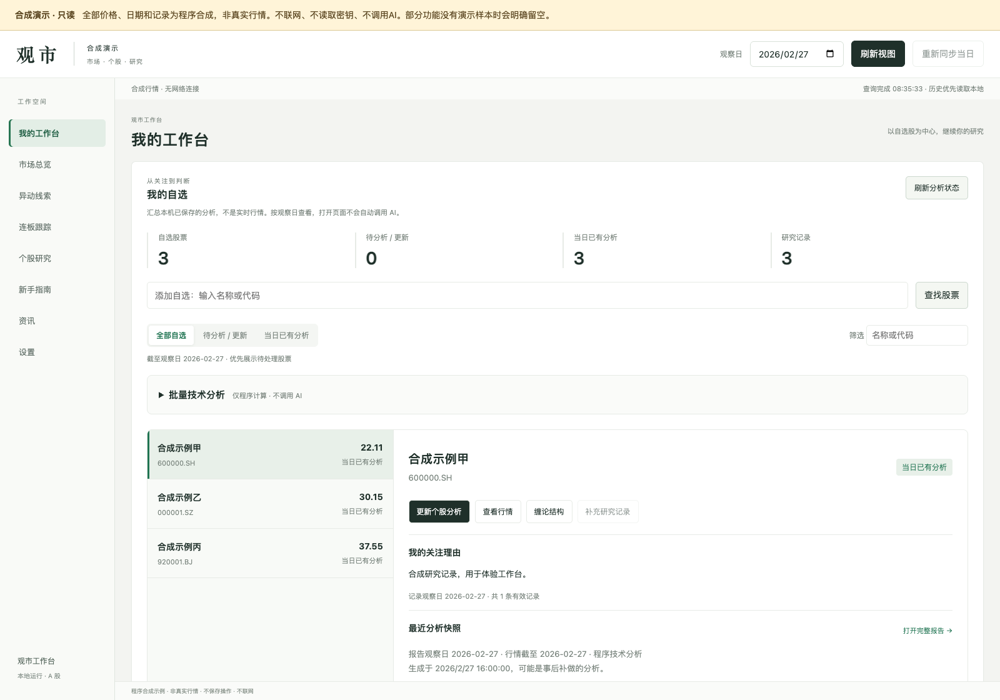
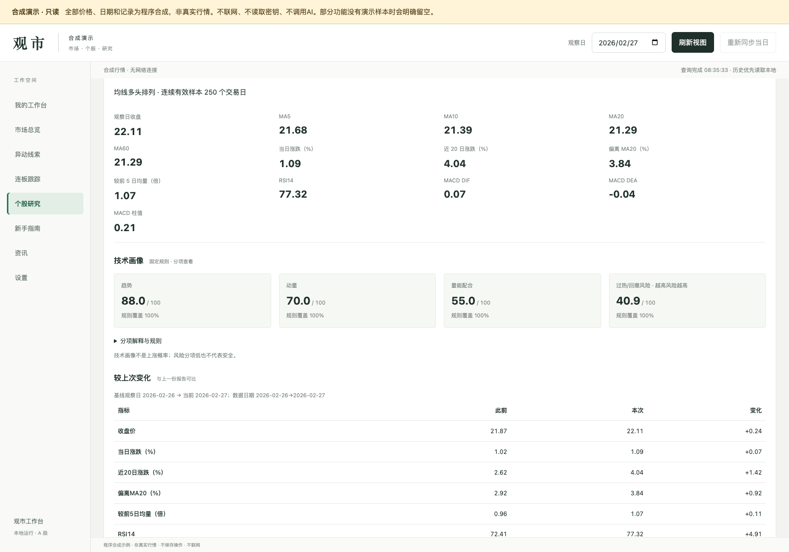
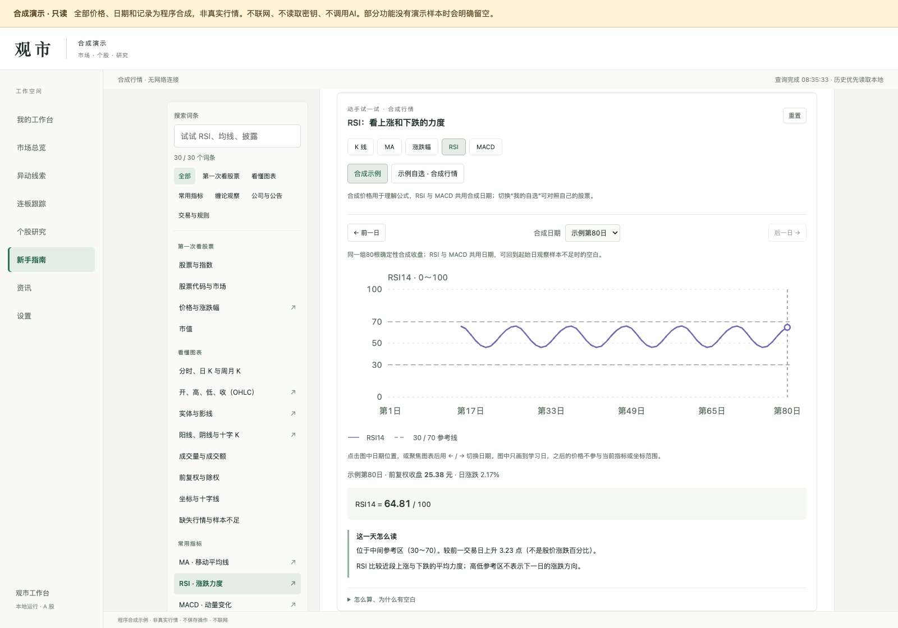

<div align="center">

# CandleAtlas · 观市

**把自选、图表、指标和复盘记录，放进一个本地工作台。**

看懂一次变化，记下关注理由，再和下一次观察对照。

公开预览 · 个人持续开发中 · Python 3.11+ · MIT

[下载源码 ZIP](https://github.com/BananaSoldier01/candleatlas/archive/refs/heads/main.zip) · [提交反馈](https://github.com/BananaSoldier01/candleatlas/issues/new/choose) · [查看 CI](https://github.com/BananaSoldier01/candleatlas/actions/workflows/ci.yml)

[看实际界面](#screenshots) · [先跑合成演示](#quick-start) · [使用真实行情](#real-data) · [一起改进](#contribute)

</div>



> 截图来自当前可运行的应用，图中的股票、日期和数值均为**合成演示数据**，不是实际行情或收益展示。无需 Key 就能先体验图表、样例报告与教学交互。

## 它想帮你解决什么

关注的股票在一个列表，指标解释在另一个网页，上次为什么关注却只留在记忆里。CandleAtlas 想把这几件事放在一起：**从自选开始看图，保存一次观察，再看哪些地方发生了变化。**

它适合想逐步建立观察和复盘习惯的个人用户，也适合一边看行情、一边学习指标的人。不使用 AI，也可以计算技术指标、保存技术报告。

| 想做的事 | 在观市里怎么做 |
| --- | --- |
| 每次打开都能接着看 | 在工作台管理自选、记录关注理由、打开已有报告 |
| 不只看一句“偏强/偏弱” | 把 MA、量价标记、RSI、MACD 放回 K 线与日期里看 |
| 知道这次与上次哪里不同 | 查看分项技术画像和报告对比；不可比时明确提示 |
| 遇到不懂的指标，边看边学 | 30 个常用词条、5 类交互图解，可切换自己的行情 |
| 核对消息与业绩依据 | 按观察日看已采集线索、披露材料和可用版本；缺失不补造 |

<a id="screenshots"></a>

## 看看现在能用的界面

### 从自选开始，留下关注理由

工作台集中显示自选、研究记录和已有分析。批量技术分析默认折叠，需要时再展开；正式模式可以批量生成不调用 AI 的技术报告。



### 复盘时，看变化，也看解释

技术画像按趋势、动量、量能配合和过热/回撤风险分项展示。报告对比保留日期、方法和窗口限制，不能比较的地方不会硬给涨跌方向。



### 看不懂，就动手试一试

从一根 K 线、均线和涨跌幅开始，再到 RSI 与 MACD。切换日期、修改合成示例，或者配置数据源后对照自己的自选股学习。



<a id="quick-start"></a>

## 先体验：无需 Key，不调用 AI

需要 **Python 3.11 或更新版本**。下载并解压源码，在实际解压目录中打开终端（GitHub ZIP 通常解压为 `candleatlas-main`），不需要安装第三方 Python 包或前端依赖：

```sh
python3 server.py --demo --port 8765
```

在浏览器打开 [http://127.0.0.1:8765](http://127.0.0.1:8765)。macOS 也可双击 `启动演示.command`。如果该端口已被占用，程序会用中文提示实际端口，并给出可复制的换端口命令，例如 `--port 8766`。

你可以浏览合成自选、日/周/月 K、指标、技术画像、样例报告对比和教学图解。演示是**只读**的：不读取密钥、不连接外部数据源、不调用模型、不写用户数据库。真实新闻、公告、部分线索等没有演示样本时会明确留空。

**演示不等于在线行情服务。** 合成日历只按工作日生成，不代表交易所休市安排。当前项目也不提供公开托管的在线分析服务。

<a id="real-data"></a>

## 换成自己的股票和行情

正常模式启动：

```sh
python3 server.py
```

打开左侧“设置”，配置自己的同花顺数据 API Key；也可复制 `.env.example` 为 `.env.local` 后填写。然后添加自选，查看行情、记录研究理由并生成技术报告。真实模式从空的本地资料库开始，不会自带作者的自选、报告或缓存。

| 功能 | 需要准备什么 |
| --- | --- |
| 合成演示、合成教学示例 | 无需 Key，先试用界面与交互 |
| 真实行情、技术分析、自选行情教学 | 自行配置行情数据 Key；覆盖和额度以服务商为准 |
| 主题/业绩线索、历史披露材料 | 对应观察日真实采集、归档和核验的资料；部分日期可能缺失 |
| 可选 AI 解读 | 另行配置兼容 Chat Completions 的模型服务；只在手动触发时调用 |

行情数据接口和 AI 模型是两项独立配置，都可能产生服务商费用。技术分析与批量技术报告可以不使用 AI。开启 AI 时，分析材料会发给你配置的模型服务，请先核对服务与数据使用范围。

<a id="contribute"></a>

## 当前阶段：欢迎试用，也欢迎指出不好用的地方

这是一个作者自己正在使用和持续优化的个人项目。当前先开放可运行的版本，想了解别人实际怎么用、哪里看不懂、哪些流程值得改进。

尤其欢迎这几类反馈：

- **用起来不顺**：附页面、操作步骤、预期和实际结果。
- **数据或指标有疑问**：附股票代码、观察日、窗口和来源，方便复现核对。
- **新手读不懂**：指出哪个术语、图例或解释让你困惑。
- **想贡献代码**：从一个小问题开始，用独立分支和 PR 提交。

欢迎[提交使用反馈](https://github.com/BananaSoldier01/candleatlas/issues/new/choose)或[查看现有问题](https://github.com/BananaSoldier01/candleatlas/issues)。反馈时请遮去 Key、个人记录和私人数据。参考 [贡献指南](CONTRIBUTING.md)、[Agent 约定](AGENTS.md) 和 [首批待办](ROADMAP.md)。

另附一个无需后端的[静态介绍页](site/index.html)：下载后直接打开即可浏览，也可以单独部署为项目介绍。它展示截图和使用方式，不是在线运行的分析应用。

<details>
<summary><strong>使用前了解：数据、指标与实验功能的边界</strong></summary>

- 观察日优先使用同日归档，历史缺失不以最新数据替代；采集条数对齐不代表全市场事件完整。
- 价格缺口不补零。RSI14 至少需要 15 根连续有效日 K；MACD(12,26,9) 至少需要 60 根，柱值为 `2 × (DIF − DEA)`。窗口初始化与前复权修订可能影响结果。
- 日期型公告按次日 00:00（北京时间）保守可用；当前取得的历史索引不能证明当时网页或 PDF 的实际版本。
- 缠论结构与候选观察仍属实验功能。候选默认关闭并标注“未确认”；技术画像不是上涨概率或收益承诺。
- 配置、记录和缓存保存在本机 `data/` 目录，不随源码分发。不要把 `.env.local`、用户库、行情缓存或公告 PDF 提交到公开仓库。
- 当前已在 macOS 做本地验证；Windows 尚待独立使用验证。真实外部数据源和模型的覆盖、兼容性与质量需自行核对。

</details>

<details>
<summary><strong>开发与离线测试</strong></summary>

测试使用临时目录、假传输和合成数据，不需要真实 Key，不应调用付费模型。

```sh
python3 -m unittest discover -s tests -q
node --test tests/test_guide.js tests/test_price_technical.js
python3 scripts/check_release.py
```

Node.js 仅用于开发测试，运行应用不需要 Node，开发建议使用 Node 22 或更新版本。CI 配置覆盖 Python 3.11、3.12、3.14；配置不代表已经在线执行成功，结果以仓库 Actions 为准。

</details>

## 可选：指数官方文件（默认不联网）

`index_official.py` 提供只读函数 `fetch_constituents`、`fetch_weights`、`fetch_valuation`，用来对照一只指数在官方文件里的成分、权重和估值列。入口是中证指数（csindex 的 cons / closeweight / indicator 文件）或国证指数（cnindex 的样本导出与估值文件）。调用方要显式选择来源；一次只读那一条路径。

默认 `allow_network=False`。没有传入文件字节时只返回缺口，不会在同花顺失败后自动改走这里。成分数量、权重和文件日期用于教学对照。指数点位与估值字段不是买卖建议，模块也不做个股估值筛选。官方文件的再分发和商用条款未审，程序许可不含数据再分发权，维护者复核前不要联网拉取或把结果放进发行包。详见 [THIRD_PARTY_NOTICES.md](THIRD_PARTY_NOTICES.md)。

## 许可与来源

项目自身代码采用 [MIT](LICENSE)。第三方许可和数据来源见 [THIRD_PARTY_NOTICES.md](THIRD_PARTY_NOTICES.md)。源码许可不包含外部行情、公告 PDF 或其他内容的再分发权。
